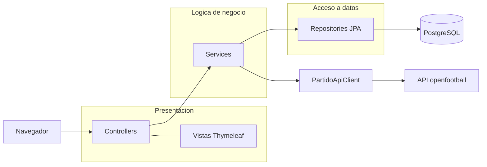
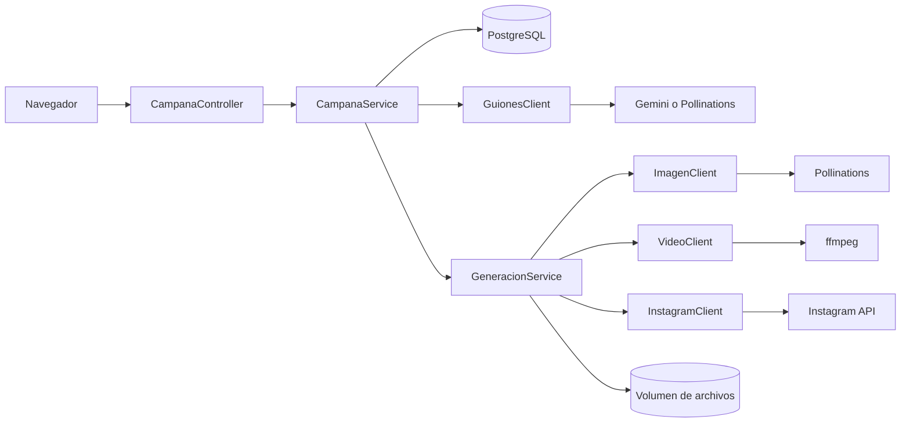

# Lab 5 - Despliegue

Diseno de Software, UTEC. Dos aplicaciones en Java 17 con Spring Boot, Thymeleaf, JPA y PostgreSQL, dockerizadas y desplegadas en AWS EC2.

| Aplicacion | Carpeta | URL | Imagen |
|---|---|---|---|
| Predicciones Champions League | `champions/` | https://champions.silosense.dev | `raith726/champions-app:1.0` |
| Estudio de marketing | `marketing/` | https://marketing.silosense.dev | `raith726/marketing-app:1.0` |

## Pregunta 1: Champions League

Arquitectura en 3 capas:



Flujo de datos:

1. Al arrancar, `CargaInicial` llama a `PartidoService.cargarDesdeApi()`.
2. `PartidoApiClient` pide el JSON de la temporada 2024/25 y lo convierte en objetos `Partido`.
3. El servicio guarda solo los partidos que no existen, por eso reiniciar no duplica datos.
4. `GET /partidos` muestra los partidos guardados.
5. `POST /partidos/{id}/prediccion` valida que el marcador coincida con el resultado y guarda la `Prediccion` con su `partido_id`.
6. `GET /predicciones` muestra las predicciones con el marcador real del partido.

Fuente de datos: https://raw.githubusercontent.com/openfootball/football.json/master/2024-25/uefa.cl.json

### Ejecucion local

```bash
cd champions
cp .env.example .env
docker compose up -d --build
```

Abrir http://localhost:8080. El puerto se cambia con `APP_PORT`.

## Pregunta 2: Estudio de marketing



Flujo:

1. El usuario sube una foto y describe el negocio.
2. El sistema propone 3 guiones con IA. Con `GEMINI_API_KEY` la IA analiza la foto; sin ella usa la descripcion.
3. El usuario elige un guion.
4. El sistema genera 3 fotos con IA y arma un video vertical de 16 segundos con ffmpeg.
5. Al publicar, sube un carrusel con las fotos y un reel con el video a Instagram, y guarda los enlaces.

TikTok no se usa porque exige auditar la aplicacion antes de publicar contenido publico.

### Ejecucion local

```bash
cd marketing
cp .env.example .env
docker compose up -d --build
```

Abrir http://localhost:8081.

Variables de `.env`:

| Variable | Uso |
|---|---|
| `DB_NAME`, `DB_USER`, `DB_PASSWORD` | Base de datos |
| `APP_PORT` | Puerto publicado |
| `APP_BASE_URL` | URL publica, Instagram descarga los archivos desde ahi |
| `PUBLICAR_CLAVE` | Clave que pide el formulario para publicar |
| `GEMINI_API_KEY`, `GEMINI_MODEL` | Analisis de la foto (opcional) |
| `INSTAGRAM_USER_ID`, `INSTAGRAM_TOKEN` | Cuenta profesional de Instagram |

## Despliegue en AWS

1. Crear una instancia EC2 Ubuntu t3.small con los puertos 22, 80 y 5000 abiertos.
2. Instalar Docker en la instancia.
3. Publicar las imagenes desde la PC:

```bash
docker login
cd champions && docker compose build && docker compose push app
cd ../marketing && docker compose build && docker compose push app
```

4. Copiar a la instancia cada `docker-compose.yml` con su `.env`. En AWS se usa `APP_PORT=80` para Champions, `APP_PORT=5000` para marketing y `APP_BASE_URL=https://marketing.silosense.dev`.
5. En cada carpeta ejecutar:

```bash
docker compose pull app
docker compose up -d --no-build
```

6. Para el dominio se crea un tunel de Cloudflare y se levanta `deploy/docker-compose.tunel.yml` con la variable `TUNNEL_TOKEN`:

```bash
cd deploy
docker compose -f docker-compose.tunel.yml up -d
```

Los datos quedan en los volumenes `champions_data`, `marketing_data` y `marketing_media`, asi que sobreviven al reinicio de los contenedores.
